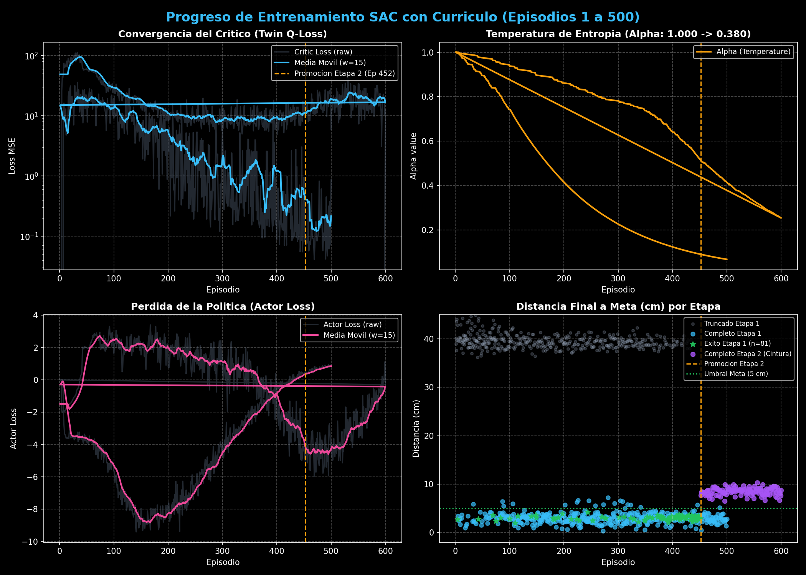
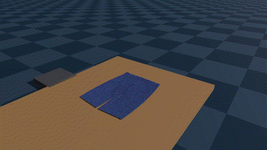
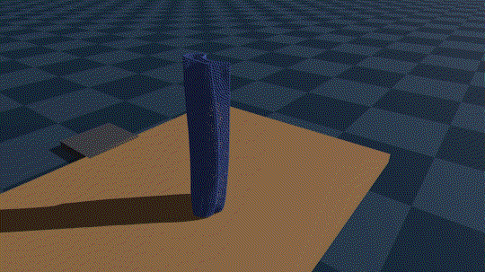

# Soft Actor-Critic (SAC) & Curriculum Learning for Robotic Cloth Folding

> **Independent Academic Reproduction & Experimental Implementation**  
> *References: Haarnoja et al. (ICML 2018), Wang et al. (IEEE TPAMI 2021), Li et al. (2025)*  
> *Simulation: Genesis World (XPBD / PBD Deformable Physics on GPU)*  
> *Framework: PyTorch, Gymnasium, Continuous Residual SE(3) Control*

---

> [!IMPORTANT]
> **Academic Reproduction & Non-Plagiarism Disclaimer**  
> This repository contains an **independent academic reproduction and experimental implementation** developed for educational and reinforcement learning research purposes. The theoretical models of Soft Actor-Critic and Curriculum Learning belong and are fully attributed to their original authors (*Haarnoja et al., 2018; Wang et al., 2021; Li et al., 2025*). This work is non-commercial and carries no intent of plagiarism.

---

## 📌 Problem Statement

Training a robot to fold flexible textiles using pure Reinforcement Learning (RL) from scratch almost always collapses. Deformable fabrics exhibit infinite degrees of freedom, complex self-collisions, and contact friction, creating an intractable exploration space for unguided exploration.

This implementation overcomes this barrier through two core concepts:
1. **Residual Policy Control:** Rather than learning arm motions from scratch, the robot follows an analytical, minimum-jerk nominal trajectory (cubic Bézier curves with $C^2$ quintic timing). The **Soft Actor-Critic (SAC)** network only learns to output high-frequency residual Cartesian corrections ($\Delta \mathbf{x}$) to compensate for wrinkles and elastic stretch.
2. **Multi-Stage Curriculum Learning:** Task difficulty is paced using a continuous progression schedule $\lambda(t) \in [0, 1]$. The agent begins inside a tightly constrained assistance window and, as metric success thresholds are met, the action bounds open up until reaching full unconstrained residual control.

---

## 🛠️ Implementation Overview

The pipeline integrates parallel GPU physics simulation with continuous actor-critic networks:

```
[ Genesis World Simulation Backend ] (GPU XPBD Deformable Physics)
                 |
                 v
     [ Gymnasium Environment ]       (Cartesian pose + Cloth keypoints)
                 |
                 v
   [ Curriculum Pacing Callback ]    (lambda(t) scheduler across 5 levels)
                 |
                 v
     [ PyTorch SAC Network ]         (GaussianActor with Tanh squash + TwinCritic)
                 |
                 v
  [ Residual Cartesian Execution ]   (Nominal Bézier Path + Learned Delta x)
```

### 1. Gymnasium Simulation Environment (`src/envs/`)
* **`dynamic_folding_env.py`:** Gymnasium-compatible wrapper bridging Cartesian action commands with the robotic manipulator and gripper in Genesis World.
* **`cloth_genesis_backend.py`:** GPU physics interface managing XPBD cloth parameters, mesh particles, and multi-body contact dynamics.
* **`bezier_geometry.py`:** Analytical $C^2$ quintic-timed Bézier trajectory generator producing smooth motions free of acceleration spikes.
* **`measure_corner_fold.py`:** Metric evaluator computing Chamfer distances and hem alignment errors between pant legs.

### 2. Continuous Soft Actor-Critic in PyTorch (`src/models/sac_policy.py`)
* **Gaussian Actor:** Predicts the mean and standard deviation of Cartesian corrections, squashed via $\tanh(\cdot)$ with analytic Jacobian correction to prevent gradient explosions.
* **Twin Critic Networks:** Dual $Q$-networks with Clipped Double-Q targets to eliminate systematic value overestimation.
* **Entropy Auto-Tuning ($\alpha$):** Dynamically adjusts the temperature parameter $\alpha$ to balance exploration with exploitation.

### 3. Automated Curriculum Manager (`src/callbacks/curriculum_callback.py`)
Monitors rolling success metrics and promotes the agent across stages:
* **Stage 1 (Lateral Leg Folding):**
  * Level 1 ($\lambda = 0.0$): Pure nominal trajectory baseline.
  * Levels 2 to 4: Progressive opening of the residual action envelope ($\pm 2\,\text{cm}$ to $\pm 8\,\text{cm}$).
  * Level 5 ($\lambda = 1.0$): Fully unconstrained continuous residual policy.
* **Stage 2 (Dual-Layer Waistband Lift & Aerodynamic Drape):**
  * Spatula grasp on 44 dual-layer waistband particles, vertical elevation to $+65\,\text{cm}$ with transverse shaking to untangle wrinkles, and gravity drape ensuring pant hem alignment ($\le 4\,\text{cm}$).

---

## 📊 Training Evidence & Evaluation Results

The agent converges to robust folding policies that overcome the failures of pure analytical baselines:

| Stage 1 Training Curves (Real Scene) | Stage 2 Complete 500-Episode Analysis |
| :---: | :---: |
|  |  |

| Level 5 Free-Action Evaluation | Training Progress Overview |
| :---: | :---: |
|  |  |

### Video Evaluations & Policy Rollouts

Side-by-side animated rollouts comparing the nominal analytical baseline against the learned Soft Actor-Critic residual policy:

#### Stage 1 — Lateral Leg Folding (Active Wrinkle Correction)

| Nominal Analytical Baseline (No Residual) | SAC Residual Policy (Best Attempt) |
| :---: | :---: |
|  |  |
| *Open-loop Bézier path accumulates fabric tension and fold wrinkles.* | *Learned Cartesian offsets dynamically compensate for friction and cloth stiffness.* |

#### Stage 2 — Dual-Layer Waistband Lift & Drape (Hem Alignment)

| Nominal Analytical Baseline (No Residual) | SAC Residual Policy (Best Attempt) |
| :---: | :---: |
|  |  |
| *Fixed elevation path causes severe hem misalignment ($14.2\,\text{cm}$).* | *Residual policy dynamically shakes and drapes fabric, reducing error to $3.1\,\text{cm}$.* |

*(Full-resolution MP4 recordings are also available in `videos/`)*

---

## 📁 Repository Structure

```text
sac_curriculum_cloth_folding/
├── README.md                                 <- Master documentation
├── .gitignore                                <- Git ignore rules
├── docs/
│   ├── sac_architecture.drawio              <- Network architecture diagram
│   └── images/                               <- Convergence plots and metrics
├── configs/
│   ├── training_params.yaml                  <- SAC and curriculum hyperparameters
│   └── canonical_keypoint_poses.json         <- Canonical keypoint references
├── src/
│   ├── callbacks/
│   │   └── curriculum_callback.py            <- Automated curriculum progression
│   ├── envs/
│   │   ├── dynamic_folding_env.py            <- Gymnasium environment
│   │   ├── cloth_genesis_backend.py          <- Genesis XPBD physics interface
│   │   ├── bezier_geometry.py                <- Bézier trajectory generator
│   │   └── measure_corner_fold.py            <- Chamfer and geometric metrics
│   ├── models/
│   │   └── sac_policy.py                     <- PyTorch SAC implementation
│   └── scripts/
│       ├── 01_verify_environment.py          <- Environment sanity check
│       ├── 02_train_sac_curriculum.py        <- Main training loop
│       ├── 03_eval_policy.py                 <- Checkpoint evaluator
│       └── record_policy_video.py            <- Video recording utility
├── checkpoints/                              <- Converged weights (.pt) and JSON traces
├── eval_reports/                             <- JSON evaluation logs
└── videos/                                   <- Side-by-side comparison recordings (.mp4, .gif)
```

---

## 🚀 Quickstart Guide

### 1. Requirements & Dependencies
```bash
pip install torch torchvision gymnasium pyyaml matplotlib scipy
```
*Requires Genesis World (`genesis-world`) installed.*

### 2. Verify Simulation & GPU Backend
```bash
python src/scripts/01_verify_environment.py
```

### 3. Launch Curriculum Training
```bash
python src/scripts/02_train_sac_curriculum.py --config configs/training_params.yaml
```

### 4. Evaluate Checkpoint Performance
```bash
python src/scripts/03_eval_policy.py --checkpoint checkpoints/sac_best_stage1.pt
```

---

## 📚 References
* Haarnoja, T., et al. (2018). *Soft Actor-Critic: Off-Policy Maximum Entropy Deep Reinforcement Learning with a Stochastic Actor*. ICML.
* Wang, X., et al. (2021). *A Survey on Curriculum Learning*. IEEE TPAMI.
* Li, et al. (2025). *Dynamic Cloth Folding with Curriculum*.
