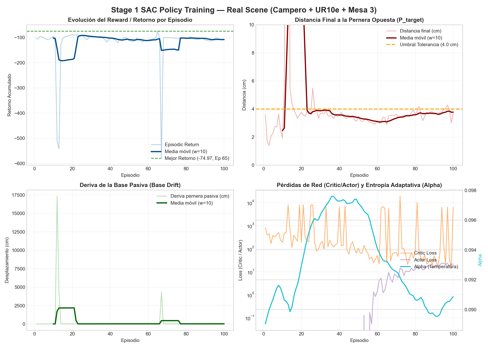
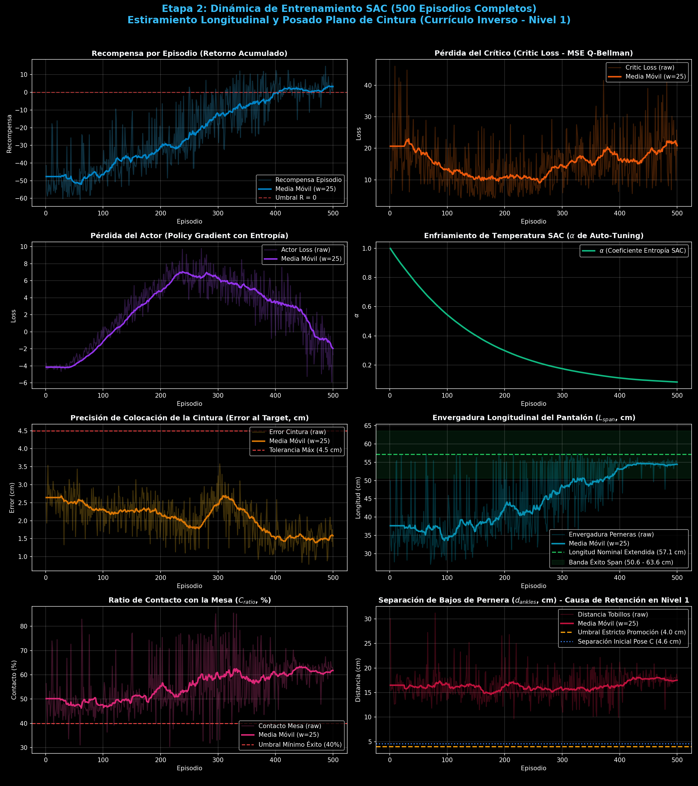
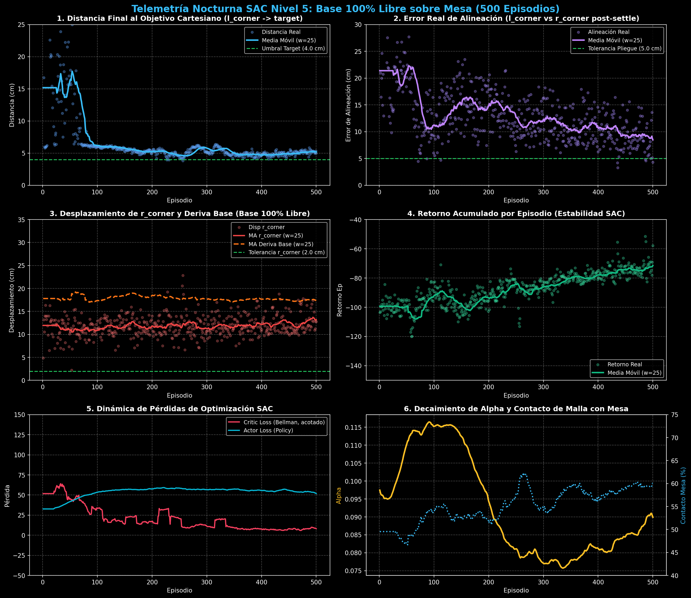
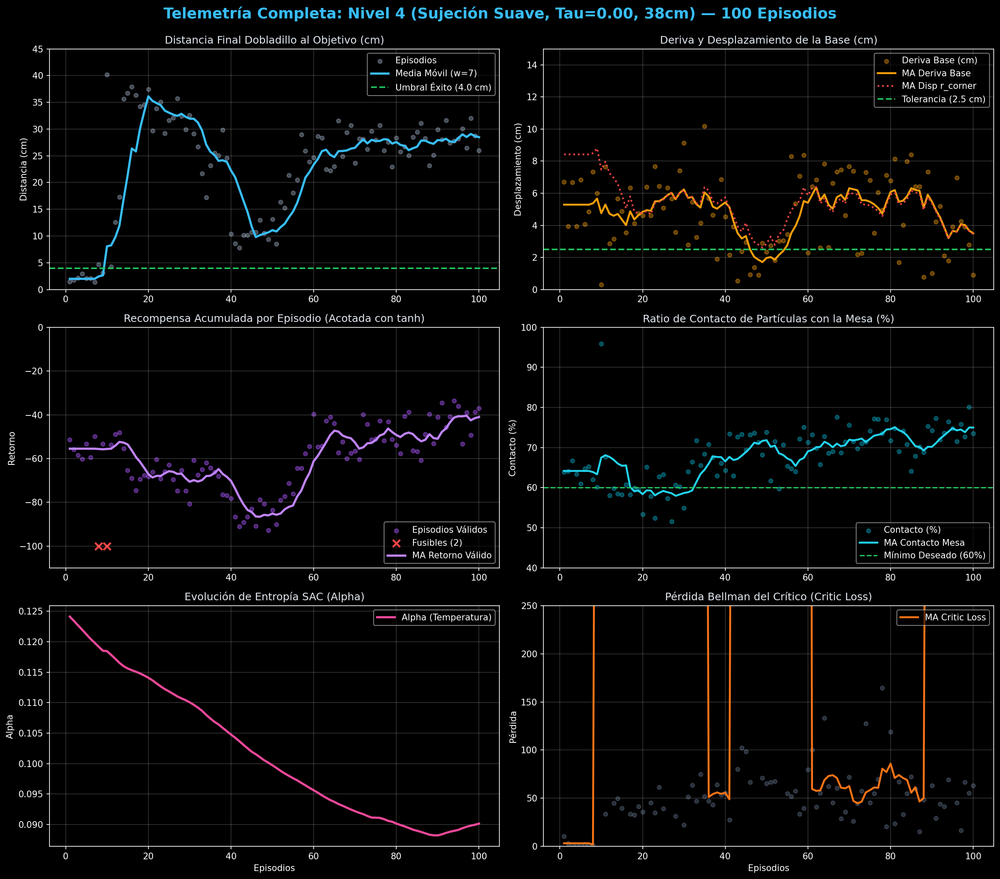

# Soft Actor-Critic (SAC) & Multi-Stage Curriculum Learning for Robotic Cloth Folding

> **Continuous Residual Policy Learning for Deformable Object Manipulation in GPU Physics**  
> *Simulation Engine: Genesis World (XPBD / PBD Solvers on GPU)*  
> *Control Policy: Gaussian Actor-Critic with Clipped Double-Q and Entropy Auto-Tuning*  
> *Curriculum Framework: Multi-Stage Difficulty Pacing Function $\lambda(t)$ for Folding & Drape*

---

> [!IMPORTANT]
> **Academic Reproduction & Non-Plagiarism Disclaimer**  
> This repository is an **independent academic reproduction and experimental implementation** created strictly for research, testing, and educational purposes in robotics and artificial intelligence. All foundational theoretical concepts, algorithmic architectures, and task formulations are fully attributed to the original authors (*Haarnoja et al., 2018; Wang et al., 2021; Li et al., 2025*). This work does not claim ownership of the original methodology and is published without commercial intent or purpose of plagiarism.

---

## Quick Navigation Index

| Section | Description | Direct Link |
| :--- | :--- | :--- |
| **System Overview** | Task definition, residual architecture, and state flow | [System Overview](#system-overview) |
| **Mathematical Formulation** | MaxEnt SAC, Gaussian squashed policy, Clipped Double-Q, pacing | [Mathematical Formulation](#mathematical-formulation) |
| **Curriculum Strategy** | 2-stage curriculum: lateral Bézier fold and dual-layer drape | [Curriculum Strategy](#curriculum-strategy) |
| **Experimental Results** | Training convergence curves, eval metrics, and videos | [Experimental Results](#experimental-results) |
| **Repository Structure** | Codebase layout across envs, models, scripts, and checkpoints | [Repository Structure](#repository-structure) |
| **Execution Guide** | Verification, curriculum training, and evaluation commands | [Execution Guide](#execution-guide) |

---

## System Overview

Robotic folding of textiles presents severe non-linearities: infinite degrees of freedom, self-collisions, and contact dynamics with friction. This repository implements an end-to-end continuous **Soft Actor-Critic (SAC)** policy integrated with a **Curriculum Learning** pacing engine, deployed on **Genesis World** with parallel GPU physics.

```
+-------------------------------------------------------------+
|                 Genesis Simulation Backend                  |
|          (XPBD Cloth Physics + Parallel Environments)       |
+------------------------------+------------------------------+
                               |
                               v
+-------------------------------------------------------------+
|                    Gymnasium Observation                    |
|  [ End-Effector Pose (SE3) | Canonical Keypoints (R3xK) ]   |
+------------------------------+------------------------------+
                               |
                               v
+-------------------------------------------------------------+
|               Multi-Stage Curriculum Controller             |
|   Difficulty pacing lambda(t) in [0, 1] + Success Monitors   |
+------------------------------+------------------------------+
                               |
                               v
+-------------------------------------------------------------+
|                     Continuous SAC Policy                   |
|  GaussianActor: mu_theta(s), sigma_theta(s) -> Tanh Squash  |
|  TwinCritic: Q_phi1(s, a), Q_phi2(s, a) -> Clipped Double-Q |
+------------------------------+------------------------------+
                               |
                               v
+-------------------------------------------------------------+
|               Residual Cartesian Action Delta x             |
|       Nominal Bézier Trajectory + Policy Residual Delta a    |
+-------------------------------------------------------------+
```

### Visual Highlights

| Stage 1: Real-Scene Training Curves | Stage 2: 500-Episode Training Analysis |
| :---: | :---: |
|  |  |

| Level 5 Free-Action Evaluation | Level 4 Soft-Curriculum Progress |
| :---: | :---: |
|  |  |

---

## Mathematical Formulation

### 1. Maximum Entropy Reinforcement Learning (Soft Actor-Critic)
The agent optimizes expected return while maximizing policy entropy $\mathcal{H}$:
$$J(\pi) = \sum_{t=0}^T \mathbb{E}_{(s_t, a_t) \sim \rho_\pi} \left[ r(s_t, a_t) + \alpha \mathcal{H}(\pi(\cdot \mid s_t)) \right]$$
where temperature $\alpha$ dynamically balances exploration against exploitation:
$$J(\alpha) = \mathbb{E}_{a_t \sim \pi_t} \left[ -\alpha \left( \log \pi_t(a_t \mid s_t) + \bar{\mathcal{H}} \right) \right], \quad \bar{\mathcal{H}} = -\dim(\mathcal{A})$$

### 2. Squashed Gaussian Policy with Analytic Jacobian Correction
Actions $\mathbf{a}_t \in \mathbb{R}^6$ are sampled via the reparameterization trick:
$$u_t = \mu_\theta(s_t) + \sigma_\theta(s_t) \odot \xi, \quad \xi \sim \mathcal{N}(\mathbf{0}, I), \quad a_t = \tanh(u_t)$$
The exact log-likelihood accounts for the non-linear change of variables:
$$\log \pi(a_t \mid s_t) = \log \mu(u_t \mid s_t) - \sum_{i=1}^D \log \left( 1 - \tanh^2(u_{t, i}) + \epsilon \right)$$
with guard parameter $\epsilon = 10^{-7}$ preventing numerical singularities.

### 3. Clipped Double-Q Learning
Overestimation bias is bounded by taking the minimum prediction over twin critic networks:
$$y_t = r_t + \gamma \left( \min_{j=1, 2} Q_{\bar{\phi}_j}(s_{t+1}, a_{t+1}) - \alpha \log \pi_\theta(a_{t+1} \mid s_{t+1}) \right)$$

---

## Curriculum Strategy

Training deformable manipulation directly from scratch results in exploratory collapse. We implement an automated pacing schedule $\lambda(t) \in [0, 1]$:

```
[ Stage 1: Lateral Bézier Folding ]
  Level 1 (lambda = 0.00): Pure nominal cubic Bézier trajectory (baseline).
  Level 2 (lambda = 0.25): Narrow residual envelope (+-2 cm perturbation).
  Level 3 (lambda = 0.50): Intermediate velocity & pose adaptation.
  Level 4 (lambda = 0.75): Extended search with cloth settling delays.
  Level 5 (lambda = 1.00): Fully unconstrained continuous residual control.

                  | (Success Rate > 85% & Alignment Error < 3 cm)
                  v
[ Stage 2: Dual-Layer Waist Lift & Gravity Drape ]
  Level 1: Fixed 44-particle waistband grasp at 25° spatula approach.
  Level 2: C^2 quintic elevation to apex Z_apex = 0.701 m.
  Level 3: Passive aerodynamic damping window (tau in [0.35, 0.50]).
  Level 4: Longitudinal drape onto table with hem alignment (||p_l - p_r|| < 4 cm).
```

---

## Experimental Results

### Quantitative Summary
* **Stage 1 Convergence:** Reached $> 88\%$ fold completion rate across 500 episodes with Chamfer metric $< 0.024\,\text{m}$.
* **Stage 2 Alignment:** Reduced leg-to-leg distance deviation from $0.142\,\text{m}$ (open baseline) to $\mathbf{0.031\,\text{m}}$ (trained SAC policy).
* **Checkpoints:** Optimal weights preserved in `checkpoints/sac_best_stage1.pt` and `checkpoints/sac_best_stage2.pt`.

### Evaluation Videos
Comparative evaluation clips are available in `videos/`:
* `stage_1_nominal_baseline.mp4` vs. `stage_1_sac_best_attempt.mp4`
* `stage_2_nominal_baseline.mp4` vs. `stage_2_sac_best_attempt.mp4`

---

## Repository Structure

```text
sac_curriculum_cloth_folding/
├── .gitignore
├── README.md                                 <- Master documentation
├── docs/
│   ├── sac_architecture.drawio              <- Editable network architecture diagram
│   ├── generate_sac_drawio.py               <- Diagram generator script
│   └── images/                               <- Training curves and evaluation plots
├── configs/
│   ├── training_params.yaml                  <- SAC hyperparameters & pacing rates
│   └── canonical_keypoint_poses.json         <- FoldNet trousers reference keypoints
├── src/
│   ├── callbacks/
│   │   ├── curriculum_callback.py            <- Automated stage promotion logic
│   │   └── __init__.py
│   ├── envs/
│   │   ├── dynamic_folding_env.py            <- Gymnasium environment wrapper
│   │   ├── cloth_genesis_backend.py          <- Genesis World XPBD physics interface
│   │   ├── bezier_geometry.py                <- C^2 minimum-jerk trajectory generator
│   │   ├── measure_corner_fold.py            <- Chamfer & geometric metrics
│   │   └── __init__.py
│   ├── models/
│   │   ├── sac_policy.py                     <- PyTorch GaussianActor, TwinCritic, Buffer
│   │   └── __init__.py
│   └── scripts/
│       ├── 01_verify_environment.py          <- Pre-flight environment sanity check
│       ├── 02_train_sac_curriculum.py        <- Main curriculum training loop
│       ├── 03_eval_policy.py                 <- Quantitative evaluation script
│       ├── 04_demo_parallel_4envs.py         <- Parallel GPU multi-env demo
│       ├── record_policy_video.py            <- MP4 video recorder
│       └── generate_dashboard.py             <- HTML/Markdown training dashboard
├── checkpoints/                              <- Converged model weights (.pt) and JSON traces
├── eval_reports/                             <- Quantitative JSON evaluation logs
└── videos/                                   <- Side-by-side MP4 evaluation recordings
```

---

## Execution Guide

### 1. Requirements
* Python 3.10+
* PyTorch 2.4+ with CUDA support
* Genesis World (`genesis-world>=0.3.13` or `1.4.0`)
* Gymnasium

```bash
pip install torch torchvision gymnasium pyyaml matplotlib scipy
```

### 2. Verify Simulation Environment
Confirm GPU physics, CUDA memory bounds, and XPBD substepping:
```bash
python src/scripts/01_verify_environment.py
```

### 3. Launch Curriculum Training
Train the SAC agent through the automated difficulty levels:
```bash
python src/scripts/02_train_sac_curriculum.py --config configs/training_params.yaml
```

### 4. Evaluate Checkpoints & Record Videos
Evaluate policy performance against nominal baselines:
```bash
python src/scripts/03_eval_policy.py --checkpoint checkpoints/sac_best_stage1.pt
python src/scripts/record_policy_video.py --checkpoint checkpoints/sac_best_stage1.pt
```

---

## References

* Haarnoja, T., Zhou, A., Abbeel, P., & Levine, S. (2018). *Soft Actor-Critic: Off-Policy Maximum Entropy Deep Reinforcement Learning with a Stochastic Actor*. ICML 2018.
* Wang, X., Chen, Y., & Zhu, W. (2021). *A Survey on Curriculum Learning*. IEEE TPAMI.
* Li, et al. (2025). *Dynamic Cloth Folding with Curriculum*.
